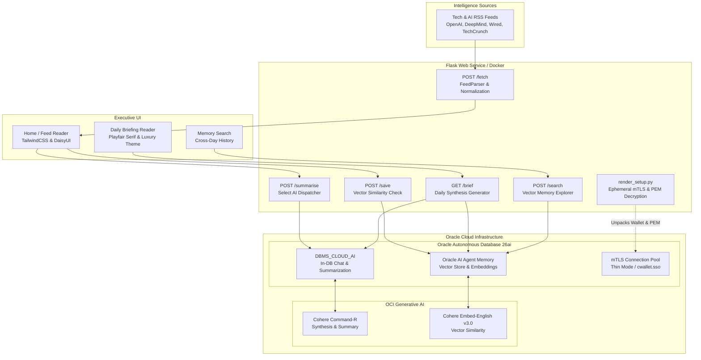

# 📰 News Brief — Executive AI Daily Briefing & Memory Agent

<p align="center">
  
  
  
  
  
  
  
</p>

<p align="center">
  <strong>An in-database executive AI briefing engine powered by Oracle Autonomous Database 26ai, OCI Generative AI, and Oracle AI Agent Memory.</strong>
  <br />
  Reads your RSS intelligence streams, connects multi-day story arcs, and synthesizes structured editorial digests in a distinct procedural voice.
</p>

---

> [!NOTE]
> ### 👤 Contributor Note & Engineering Scope
> This project originated from an AI engineering masterclass template by **Casius Lee**. 
> As part of extending and productionizing the application, **Khuzaima Hassan** architected and implemented:
> - **Production Deployment Architecture:** Dockerized the full stack for stateless, zero-cost cloud hosting on Render.
> - **Zero-Exposure Secret Injection Pipeline:** Built an automated memory-decoding pipeline (`render_setup.py`) allowing secure mTLS Oracle Wallet `.zip` extraction and OCI `.pem` credential resolution in cloud environments without committing secrets to Git.
> - **Dynamic Environment Interceptor:** Designed adaptive path routing in `db.py` to seamlessly operate across both local Windows workstations and Linux cloud containers.
> - **Dependency & Build Resolution:** Solved cross-package PyPI constraints between `oracleagentmemory`, `oracledb`, and `litellm`.
> - **UI & Prompt Engineering:** Hardened executive typography (Playfair Display / Outfit), eliminated conversational LLM preambles, and fine-tuned structured markdown templates.

---

## 💡 What Makes News Brief Different?

Traditional news aggregators overwhelm you with raw headlines, while generic AI summarizers output detached bullet points. **News Brief** operates as an intelligent memory agent:

1. **100% In-Database AI & Vector Storage:** Summaries and digests run *inside* Oracle using `DBMS_CLOUD_AI` (Select AI) and `OracleAgentMemory`. No third-party AI keys (OpenAI/Anthropic) are used or exposed.
2. **Four-Tier Cognitive Memory:** Automatically links developing stories across days using vector similarity to surface true follow-ups rather than duplicate noise.
3. **Executive Editorial Voice:** Governed by **Procedural Memory** to enforce concise framing: *What Happened*, *Why It Matters*, an *Analogy*, and strategic *Opportunities*.
4. **Stateless Cloud Security:** Employs an automated Base64 bootstrap pipeline so you can deploy to free PaaS tiers without purchasing expensive persistent volume mounts for mTLS keys.

---

## 🏛️ Architecture & Data Flow



---

## 🧠 Cognitive Memory Hierarchy

News Brief leverages `OracleAgentMemory` to maintain distinct memory tiers:

| Memory Tier | Role in Briefing | How It Works |
| :--- | :--- | :--- |
| **Episodic** | Cross-Day Story Linking | Stores each event with timestamp and source. When a new story is parsed, vector distance detects if it's a continuation of a past story and marks it as a follow-up. |
| **Semantic** | World Model & Industry Trends | Tracks key organizations, recurring themes, and broad industry shifts across weeks of reading. |
| **Procedural** | Stylistic & Editorial Voice | Injected style rules: British English, no em dashes, tight narrative hooks, and domain analogies. |
| **Working** | Daily Synthesis Thread | Maintains the active briefing workspace during generation to produce the final top-line digest. |

---

## 🖥️ User Interface & Views

The application provides an editorial experience inspired by luxury print journalism:

* **Executive Dashboard (`/`):** Streamlined feed reader to preview, parse, and selectively summarize raw RSS items.
* **Daily Briefing Reader (`/briefing`):**
  * **TOP LINE:** Flowing synthesized narrative identifying the unifying theme of the day.
  * **5 Top Stories:** Structured breakdown (*What Happened*, *Why It Matters*, *Your Angle*, *Sources*).
  * **Visual Polish:** Drop-cap typography, subtle noise grain texture, and high-contrast editorial styling.
* **Memory Archive & Search (`/search_view`):** Deep semantic search interface to query past stories and briefings stored in the vector database.

---

## 🛣️ API Reference

| Endpoint | Method | Payload / Params | Description |
| :--- | :---: | :--- | :--- |
| `/fetch` | `POST` | `{"url": "<rss_feed_url>"}` | Fetches and parses the latest 20 feed articles. |
| `/summarise` | `POST` | `{"title": "...", "link": "...", "content": "..."}` | Executes `DBMS_CLOUD_AI.GENERATE` inside Oracle for a 2-sentence distillation. |
| `/save` | `POST` | `{"headline": "...", "summary": "..."}` | Performs semantic search for follow-up detection and embeds into Agent Memory. |
| `/brief` | `GET` | *None* | Reads memories, applies procedural rules, and generates the day's 5-story executive briefing. |
| `/search` | `POST` | `{"query": "<text>"}` | Performs vector similarity search across all stored memories. |
| `/past_briefings` | `GET` | *None* | Retrieves all previously generated daily briefings from archive memory. |

---

## 🔐 Zero-Exposure Cloud Deployment (Render)

Deploying applications that require **Oracle mTLS Wallets** (`cwallet.sso`, `tnsnames.ora`) and **OCI Private API Keys** (`.pem`) to cloud platforms often leads to accidental credential leaks in Git or requires expensive volume storage.

News Brief solves this with an **automated in-memory bootstrap pipeline**:

1. **Local Secret Packaging:** Run the PowerShell / Python encoder locally to generate Base64 strings of your `.zip` wallet and `.pem` key.
2. **Render Environment Configuration:** Paste the variables into Render using the **"Add from .env"** bulk tool.
3. **Pre-Boot Extraction (`render_setup.py`):**
   ```python
   # Automatically executes inside Docker before Gunicorn starts
   decode_secret('WALLET_BASE64', 'Wallet_newsbrief.zip')
   extract_to_directory('wallet')
   decode_secret('OCI_KEY_BASE64', 'khuzaima.pem')
   ```
4. **Adaptive Connection Routing (`db.py`):** The application detects if it is running in the cloud container and automatically maps the connection pool to the ephemeral `./wallet` directory and `./khuzaima.pem` key.

---

## 🚀 Quickstart & Local Setup

### 1. Prerequisites
- Python 3.11+
- An Oracle Cloud Infrastructure (OCI) Account ([Always Free Tier](https://www.oracle.com/cloud/free/))
- Provisioned Oracle Autonomous Database 26ai with `DBMS_CLOUD_AI` configured

### 2. Clone Repository
```bash
git clone https://github.com/KhuzaimaHassan/News-Brief.git
cd News-Brief/flask-starter
```

### 3. Configure Environment Variables
Copy `.env.example` to `.env` and fill in your credentials:
```bash
cp .env.example .env
```
```ini
DB_USER=admin
DB_PASSWORD=your_db_password
DB_DSN=newsbrief_high
WALLET_LOCATION=./wallet

OCI_USER=ocid1.user.oc1..xxxxxx
OCI_TENANCY=ocid1.tenancy.oc1..xxxxxx
OCI_FINGERPRINT=xx:xx:xx:xx:xx:xx:xx:xx:xx:xx:xx:xx:xx:xx:xx:xx
OCI_KEY_FILE=./khuzaima.pem
OCI_COMPARTMENT_ID=ocid1.compartment.oc1..xxxxxx
OCI_REGION=us-chicago-1
```

### 4. Install Dependencies
```bash
pip install -r requirements.txt
```

### 5. Seed Memory & Launch
```bash
# Seed procedural style and sources into Oracle Agent Memory
python seed_style.py
python seed_all.py

# Launch development server
python app.py
```
Visit `http://localhost:5000` in your browser.

---

## 📦 Container Deployment (Docker)

To run the containerized build locally or deploy to Render:

```bash
docker build -t news-brief -f flask-starter/Dockerfile flask-starter
docker run -p 5000:5000 --env-file flask-starter/.env news-brief
```

---

## 📄 License & Acknowledgments

* **License:** MIT License
* **Core Foundation:** Built upon the AI Developer Advocate Masterclass curriculum by [Casius Lee](https://github.com/casius-connect).
* **Architecture & Cloud Modernization:** [Khuzaima Hassan](https://github.com/KhuzaimaHassan).
